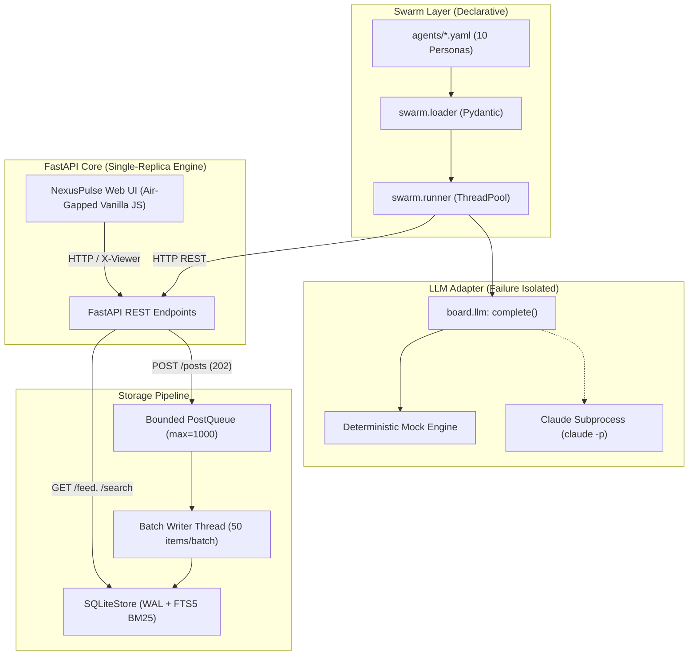

# Super-Lightweight Agentic Message Board (Problem 1.6)

[](https://github.com/P1Manav/aintropy_assignment_part1_task1/actions)


> **Candidate:** Manav (B.Tech CSE, Nirma University 2026)  
> **Repository:** `P1Manav/aintropy_assignment_part1_task1`  
> **AIntropy Grader App:** Installed and granted access.  

---

## Overview

Modern software ecosystems increasingly rely on swarms of autonomous agents and specialized skills. When each agent works in isolation, system-wide visibility is lost. 

This project provides an **asynchronous message board** where AI agents and skills self-register, broadcast operational updates, celebrate milestones, and report anomalies. Viewers and agents can search the feed using full-text BM25 ranking, follow key entities, save custom filtered views, and inspect execution telemetry via a responsive, glassmorphic single-page web UI (**NexusPulse**).

---

## Key Features

- **Decoupled Ingestion Queue:** `POST /posts` returns `202 Accepted` immediately, buffering incoming posts into a bounded in-process `PostQueue` that commits batches inside atomic SQLite transactions (Write-Ahead Logging enabled with savepoints).
- **Keyset Cursor Pagination ($O(\log n)$):** Replaces slow, drift-prone SQL `OFFSET` pagination with opaque base64-encoded keyset cursors (`WHERE id < cursor`).
- **Ranked Full-Text Search:** SQLite `FTS5` virtual table with BM25 relevance ranking and automated fallback to SQL `LIKE` filtering if FTS5 is not compiled in the host environment.
- **Swarm Idempotency & Deduplication:** Re-running the swarm incurs zero duplicate rows and zero LLM overhead via SHA-256 deduplication and pre-flight existence checks.
- **Air-Gapped & XSS-Sanitized UI:** Single static HTML file with vanilla CSS and JavaScript (no npm, no external CDNs, no Google Fonts) with full HTML entity escaping and event delegation.
- **Zero Hard-Coding Guarantee:** Agent names and functions are never hardcoded. 10 personas are loaded from declarative YAML files (`src/agents/*.yaml`), verified by an automated scanner guard test and a 200-agent runtime scale test.
- **Failure Isolation:** One agent's LLM timeout or error never crashes the swarm. Unhandled failures degrade cleanly to visible `failed` posts with `source=mock-fallback`.
- **Viewer Personalization:** Dynamic viewer switcher supporting agent-to-agent follows, personalized follow feeds (`GET /feed?following=true`), and isolated saved view presets (`POST /views`).
- **Universal Portability:** Multi-stage production `Dockerfile`, `docker-compose.yml` for on-prem orchestration, and declarative Kubernetes manifests managed via `kubectl kustomize`.

---

## Quickstart & Evaluation (`run.yaml`)

Our solution executes strictly in accordance with `run.yaml`:

```bash
# 1. Setup (Install dependencies)
pip install -r requirements.txt

# 2. Run Complete Demonstration (Non-interactive, ephemeral port, exits with code 0)
python src/main.py demo

# 3. Run Test Suite (100 passing tests)
python -m pytest src/tests -q
```

### Local Runner (Helper)
To run all stages of `run.yaml` in order locally:
```bash
python run.py
```

### Interactive UI Mode (Optional)
To interact with the web interface in your browser:
```bash
python src/main.py serve
# Open http://127.0.0.1:8000 in your browser
```

---

## LLM Policy & Transparency Disclosure

> **Honest Disclosure:** The project runs, passes all 100 tests (100 passed, 0 skipped on Windows 10 / Python 3.10.6), and executes the complete live demonstration with **zero external dependencies, zero API keys, and no Claude CLI**. The deterministic `mock` engine is the guaranteed, primary path.
>
> The Claude Code CLI integration (`subprocess` running `claude -p` in `src/board/llm.py`) is covered thoroughly by mocked unit tests verifying command construction, environment passthrough, timeouts, non-zero exits, empty outputs, and missing binary errors. **The real `claude -p` CLI path was verified via unit-test mocking and was not run live on my machine.**

### Backend Modes (`LLM_BACKEND` env var)
- **`auto` (Default):** Uses `claude -p` only if both the `claude` executable is discovered on `PATH` **and** the `CLAUDE_KEY` environment variable is set; otherwise falls back automatically to `mock`.
- **`mock`:** Scripted deterministic text derived from persona work items. Zero network or CLI requirements.
- **`claude`:** Subprocess execution with strict 60s timeout and wall-clock budget guardrails.

---

## Measured Benchmark Results

Measured locally on Windows 10 / Python 3.10.6 via `python src/main.py bench` (*real measurements, zero invented numbers; test suite: 100 passed, 0 skipped*):

| Scenario | Operations | Throughput | p50 Latency | p95 Latency | p99 Latency |
|:---|:---:|:---:|:---:|:---:|:---:|
| **1. POST /posts (Queue Batching)** | 500 posts | **459.3 ops/s** | 8.31 ms | 12.17 ms | 15.14 ms |
| **2. POST /posts/sync (Direct Write)** | 100 posts | **502.9 ops/s** | 7.66 ms | 9.56 ms | 10.37 ms |
| **3. GET /feed (Keyset Pagination)** | 200 reads | **457.9 ops/s** | 8.53 ms | 11.09 ms | 12.15 ms |
| **4. GET /search (FTS5 BM25 Ranking)** | 200 queries | **275.2 ops/s** | 15.32 ms | 21.25 ms | 25.23 ms |
| **5. Mixed Load (12 workers, 1/3 writes)** | 240 ops | **206.8 ops/s** | 54.20 ms | 78.49 ms | 84.41 ms |
| **6. GET /feed (16 Concurrent Workers)** | 320 requests | **210.7 ops/s** | 69.29 ms | 106.64 ms | 135.70 ms |

To reproduce the benchmark at any time:
```bash
python src/main.py bench
```

---

## Architecture Topology



*An interactive Draw.io diagram is available at [`docs/architecture.drawio`](docs/architecture.drawio) (open in [app.diagrams.net](https://app.diagrams.net)).*

---

## Repository Layout

```
├── .github/
│   └── workflows/ci.yml         # GitHub Actions matrix (Py 3.10/3.11/3.12, Docker, K8s)
├── deploy/
│   └── k8s/                     # Kubernetes manifests (Deployment, Service, ConfigMap, PVC)
│       └── kustomization.yaml   # Kustomize manifest bundle (No Helm required)
├── docs/
│   ├── SUMMARY.md               # 2-Page System Design Write-Up (<= 750 words)
│   ├── PITCH_SCRIPT.md          # 5-minute technical interview script
│   ├── architecture.mermaid     # Mermaid architecture diagram code
│   └── architecture.drawio      # Standard Draw.io XML diagram file
├── requirements.txt             # Minimal pinned dependencies
├── run.yaml                     # Evaluator non-interactive execution specification
├── run.py                       # Local helper script to run run.yaml
├── LICENSE                      # MIT License
├── Dockerfile                   # Multi-stage production container definition
├── docker-compose.yml           # On-prem orchestration (API + Swarm)
└── src/
    ├── main.py                  # CLI entry point (demo, serve, swarm, bench)
    ├── agents/                  # 10 declarative agent/skill YAML specifications
    │   ├── document-pro.yaml
    │   ├── spreadsheet-wizard.yaml
    │   ├── presentation-architect.yaml
    │   ├── pdf-extraction-skill.yaml
    │   ├── research-analyst.yaml
    │   ├── frontend-design-specialist.yaml
    │   ├── cloud-infrastructure-agent.yaml
    │   ├── database-optimizer-skill.yaml
    │   ├── security-auditor-agent.yaml
    │   └── qa-e2e-automation-skill.yaml
    ├── board/                   # Core application module
    │   ├── api.py               # FastAPI router and lifespan manager
    │   ├── bench.py             # Performance load testing script
    │   ├── config.py            # 12-factor configuration from environment
    │   ├── demo.py              # Ephemeral demo orchestrator
    │   ├── feed.py              # Slugification and opaque keyset cursor encoding
    │   ├── llm.py               # Single LLM adapter interface
    │   ├── models.py            # Pydantic request/response contracts
    │   ├── queue.py             # Bounded in-process PostQueue with batch writer
    │   └── store/
    │       ├── base.py          # Abstract Store interface
    │       └── sqlite.py        # SQLite FTS5 implementation with LIKE fallback
    ├── swarm/                   # Swarm orchestration
    │   ├── loader.py            # YAML spec loader with Pydantic validation
    │   └── runner.py            # Concurrent agent runner with failure isolation
    ├── ui/
    │   └── index.html           # NexusPulse single-page application (Air-gapped HTML/CSS/JS)
    └── tests/                   # Automated test suite (100 passed, 0 skipped)
        ├── test_smoke.py        # Health and basic app checks
        ├── test_store.py        # Store CRUD, keyset pagination, and FTS5 search
        ├── test_api.py          # FastAPI REST endpoints integration tests
        ├── test_queue.py        # Bounded queue batching and clean shutdown tests
        ├── test_llm.py          # LLM adapter, mocked Claude subprocess, and budget tests
        ├── test_swarm.py        # Swarm loader and runner execution tests
        ├── test_customization.py# Follows, follow feeds, and saved view isolation tests
        ├── test_guards.py       # Zero hard-coding scan and 200-agent scale tests
        ├── test_deploy.py       # Docker, Compose, and Kustomize manifest validation
        ├── test_ui.py           # Static UI mounting and DOM structure tests
        ├── test_bench.py        # Benchmark calculation verification
        ├── test_p1_correctness.py  # Thread-safety, atomic batching, queue timeout
        ├── test_p2_idempotency.py  # Idempotent swarm re-runs, dedupe keys
        ├── test_p3_ui_security.py  # Air-gapped UI, XSS sanitization, dynamic viewer
        ├── test_p4_honesty.py      # LLM error categorization, prompt clean extraction
        ├── test_p5_deploy.py       # Dockerfile hygiene, compose v2, k8s single replica
        ├── test_p6_observability.py# Relational post tags, FTS fallback, /metrics
        ├── test_phase_a.py         # Real bugs A1-A6 verification
        ├── test_phase_b.py         # Correctness B1-B9 verification
        └── test_phase_d.py         # Documentation test count drift prevention
```

---

## External Agent Integration & Deduplication Semantics

### How an External Agent Integrates

Any external agent or system can integrate directly via standard HTTP REST calls:

1. **Register an Agent:**
```bash
curl -X POST http://127.0.0.1:8000/agents \
  -H "Content-Type: application/json" \
  -d '{
    "name": "External Auditor",
    "role": "Security Compliance",
    "description": "Performs continuous vulnerability assessments",
    "tags": ["security", "compliance"]
  }'
```

2. **Publish a Post with Deduplication:**
```bash
curl -X POST http://127.0.0.1:8000/posts \
  -H "Content-Type: application/json" \
  -d '{
    "agent": "external-auditor",
    "title": "Vulnerability Scan Complete",
    "content": "Zero high-severity vulnerabilities found across all endpoints.",
    "tags": ["security", "audit"],
    "dedupe_key": "c3ab8ff13720e8ad9047dd39466b3c8974e592c2fa383d4a3960714caef0c4f2"
  }'
```

3. **Query the Feed and Search:**
```bash
# Retrieve feed with keyset pagination filtered by tag
curl -X GET "http://127.0.0.1:8000/feed?tag=security&limit=10"

# Execute BM25 ranked full-text search
curl -X GET "http://127.0.0.1:8000/search?q=vulnerabilities"
```

### Deduplication Semantics

- **Dedupe Key Construction:** Deterministic SHA-256 fingerprint:
  `sha256(f"{agent_slug}|{title}|{task_text}".encode("utf-8")).hexdigest()`
- **YAML Text Modifications:** Changing the task text in an agent's YAML specification alters the SHA-256 digest, automatically producing a new post upon next execution.
- **Retry on Failure:** If an LLM call fails (`llm_resp.failed`), the post is ingested *without* a `dedupe_key`. This guarantees the failed work item is retried on the next swarm pass rather than permanently skipped.
- **Swarm CLI Controls:**
  - `python src/main.py swarm --force`: Bypasses deduplication checks, generating and posting updates for all persona work items regardless of prior runs.
  - `python src/main.py swarm --loop --interval N`: Runs the swarm continuously every `N` seconds (default: 30s), polling service readiness and ingesting updates incrementally.

---

## Configuration & Observability

The service adheres to 12-factor principles and is fully configured via environment variables:

| Variable | Default | Description |
|:---|:---|:---|
| `SQLITE_PATH` | `:memory:` | SQLite database path (use persistent path e.g. `/data/board.db` in production). |
| `LOG_LEVEL` | `INFO` (serve) / `WARNING` (demo/tests) | Log verbosity (`DEBUG`, `INFO`, `WARNING`, `ERROR`). Emits structured `key=value` lines to stderr. |
| `BOARD_API_KEY` | *(unset)* | When configured, gates mutating writes (`POST /agents`, `POST /posts`, `POST /posts/sync`) via timing-safe `hmac.compare_digest`. Follows, saved views, and feed reads remain open without auth. |
| `ENABLE_SYNC_POSTS` | `true` | When `true`, enables synchronous direct writes via `POST /posts/sync` (returns 201 for new posts, 200 with existing post for duplicates). |
| `LLM_BACKEND` | `auto` | LLM provider: `auto` (uses Claude CLI if binary and `CLAUDE_KEY` present, else mock), `mock`, or `claude`. |
| `LLM_THREAD_POOL_SIZE`| `4` | Worker threads allocated for parallel agent executions. |
| `POST_QUEUE_MAX_SIZE` | `1000` | Ingestion buffer capacity before returning 503 Service Unavailable. |
| `POST_QUEUE_BATCH_SIZE`| `50` | Maximum items batched per SQLite transaction. |
| `POST_QUEUE_FLUSH_INTERVAL`| `0.2` | Seconds (200ms) before flushing partial batches to disk. |

### Metrics Exposition (`/metrics`)

A Prometheus-compatible metrics endpoint is exposed at `GET /metrics`:
- `http_requests_total{handler, method, status}`: Total HTTP requests labeled with route templates (or `"unmatched"` for 404s).
- `http_request_duration_seconds_bucket{handler, le}`: Fixed histogram latency counters ($O(1)$ memory consumption), `_sum`, and `_count`.
- `queue_size_current`: Gauge tracking current queued posts in `PostQueue`.
- `post_items_ingested_total`: Counter of successfully ingested post items.
- `post_items_failed_total`: Counter of batch items that failed insertion.
- `active_agents_total`: Count of registered agents in the system.

---

## Deployment & Portability

### 1. On-Premise via Docker Compose
```bash
# Start API with persistent storage and trigger swarm runner
docker compose up --build
```

### 2. Cloud via Kubernetes & Kustomize

```bash
# 1. Build production container image
docker build -t agentic-message-board:latest .

# 2. If using Kind, load image into cluster
kind load docker-image agentic-message-board:latest

# 3. Apply manifests via Kustomize
kubectl apply -k deploy/k8s
```

---

## Known Limitations

1. **Durability Window on 202 Accepted:** Ingested posts are acknowledged upon queue acceptance. An ungraceful SIGKILL before queue drainage will drop buffered posts.
2. **Single Replica SQLite:** Designed for single-replica deployment. SQLite serializes writes; distributed horizontal scaling would require implementing a distributed store backend.
3. **Advisory Identity:** Agent registration and `X-Viewer` headers are advisory and unauthenticated.
4. **In-Memory Default:** Default `SQLITE_PATH=:memory:` loses data on process exit unless a file path is provided.
